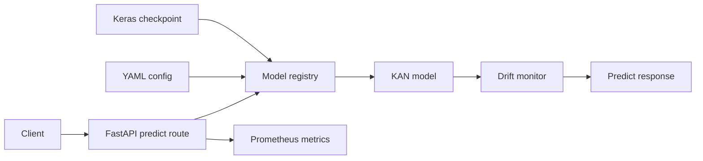

# KANX Drift Watch

Spline-network inference API that flags when live inputs leave the trained grid.



## Why

A Kolmogorov-Arnold network learns its edge functions on a fixed set of spline knots, so it only knows the range of inputs those knots were fitted to. Send it values past that range and it still answers, with a number that looks like any other. Teams that serve these models in small services find out about the problem late, usually after a batch of predictions has already been used. KANX Drift Watch keeps the grid that every layer already carries and reads it on each request, so the answer comes back with a note about how far outside the trained range the input went.

## How it works

The service loads a KAN checkpoint at startup, or builds a fresh model from the YAML config when no checkpoint is on disk. Each predict request is normalised to a batch, checked against the model's input width and the batch limit, then passed to the drift monitor before inference. The monitor walks the KAN layers, reads the per-feature knot grid of each one, and counts how many values in the batch fall below the first knot or above the last. The response carries the flagged features and their excess, and the same counts go to Prometheus.

The drift monitor is the part added on top of the base library. `DriftMonitor` in `src/kanx_drift_watch/drift.py` finds the KAN layers with `kan_layers` from `viz`, reads each layer's `grid` buffer once at construction, and folds the per-feature minimum and maximum across every layer that reads that feature into a `FeatureRange`. `ModelRegistry.set` in `api/app.py` builds the monitor from the loaded model, with a tolerance read from `DRIFT_TOLERANCE`, and keeps it beside the model; when the model holds no readable grid the monitor is skipped and the service still serves predictions. On each request the predict route calls `check()` with the normalised batch, which returns the flagged features, their largest excess, how many rows were outside and the overall maximum excess. Those values fill the `drift`, `drift_features`, `drift_excess` and `drift_samples` fields of `PredictResponse`, and the route increments a drift counter and observes the excess histogram before returning. `feature_ranges()` exposes the same ranges as plain dicts for inspection. The monitor sits between the loaded model and the response, so every prediction is scored against the grid the model was trained on without a second pass over the data.

## Key decisions

- The grid is read from the layers at request time instead of being copied into a separate reference table. The check always matches the weights in memory, at the cost of a short walk over the layers on each call.
- Out-of-range inputs are reported, not rejected. A caller can still get a prediction and decide what to do with the flag, which keeps the endpoint usable for replay and backfill traffic.
- The check runs in the same thread as inference rather than in a background job. The added latency stays small and the response is complete, but a very large batch pays for the check on the request path.
- Drift counts are exposed as Prometheus counters and histograms next to the existing inference metrics, so alerting uses the same scrape as latency and throughput.

## Tech stack

- Python 3.10 or newer
- TensorFlow 2.16 to 2.x for the KAN layers and model
- PyTorch backend for the same layers
- FastAPI and uvicorn for the REST service
- Prometheus client and the FastAPI instrumentator for metrics
- NumPy for batch handling
- Docker and a Helm chart for Kubernetes deployment

## Quick start

Prerequisites: Python 3.10 or newer, and Docker if you want the container image.

```bash
pip install -e ".[api,onnx,hub]"
uvicorn api.app:app --host 0.0.0.0 --port 8000
```

```bash
docker compose up --build
```

```bash
helm install kanx-drift-watch charts/kanx_drift_watch
```

| Variable | What it sets | Default |
| --- | --- | --- |
| `KANX_DRIFT_WATCH_CONFIG` | Path to the YAML model and training config | `configs/default.yaml` |
| `KANX_DRIFT_WATCH_CHECKPOINT` | Path to the Keras checkpoint loaded at startup | `checkpoints/kanx_model.keras` |
| `KANX_DRIFT_WATCH_MAX_BATCH` | Largest batch accepted by the predict route | `4096` |
| `KANX_DRIFT_WATCH_API_KEY` | When set, requests need a matching `X-API-Key` header | empty, auth off |
| `KANX_DRIFT_WATCH_RATE_LIMIT_RPM` | Per-IP requests per minute, 0 disables the limit | `0` |

## Usage

```bash
curl -s -X POST http://localhost:8000/api/predict \
  -H 'Content-Type: application/json' \
  -d '{"x": [[0.1, -0.2], [1.8, 0.4]]}'
```

```json
{
  "output": [[0.0412], [0.7731]],
  "shape": [2, 1],
  "inference_ms": 1.84,
  "drift": {
    "flagged": true,
    "features": [0],
    "excess": [0.8],
    "out_of_range": 1
  }
}
```

## Project structure

```text
api/                 FastAPI service and model registry
src/kanx_drift_watch/  KAN layers, model, training, inference, drift monitor
configs/             YAML model configs
charts/              Helm chart for Kubernetes
k8s/                 Plain manifests
tests/               Unit and API tests
```

## Limitations

- The check covers the input grid only. Drift inside the network, such as a shifted activation distribution, is not measured.
- A model whose grid was updated after training reports against the updated knots, not the original ones.
- The rate limiter keeps its buckets in process memory, so it does not coordinate across replicas.
- Only the TensorFlow checkpoint path is loaded at startup; the PyTorch backend is used through the library, not the service.

## License

Apache-2.0. The project builds on [KANX](https://github.com/Mattral/KANX), a TensorFlow and PyTorch implementation of Kolmogorov-Arnold networks.
